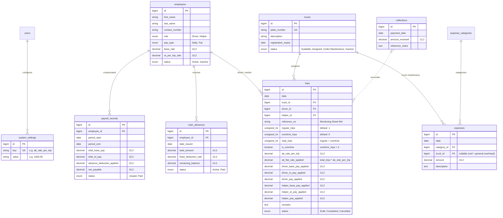

# TruckOps Backend — System Architecture, API Reference & Operations Manual

TruckOps is an enterprise-grade trucking operations and financial management API built specifically for dedicated hauling operations inside the Asia Brewery complex in Cabuyao, Laguna, Philippines. It replaces fragmented paper monitoring sheets, manual notebooks, and Excel spreadsheets with a single, highly deterministic source of truth for trip logs, driver/helper payroll, cash advances (vale), operational expenses, and client payment reconciliation.

---

## Table of Contents
1. [System Overview & Tech Stack](#1-system-overview--tech-stack)
2. [Database Schema & Entity Relationships](#2-database-schema--entity-relationships)
3. [Core Business Logic & Domain Rules](#3-core-business-logic--domain-rules)
   - [Asia Brewery Dispatch & Generalized Rate Model](#asia-brewery-dispatch--generalized-rate-model)
   - [Mixed Driver & Helper Compensation Engine](#mixed-driver--helper-compensation-engine)
   - [Automated Cash Advance (Vale) Deductions](#automated-cash-advance-vale-deductions)
   - [Financial Reconciliation & Outstanding Balances](#financial-reconciliation--outstanding-balances)
4. [API Architecture & Complete Endpoint Reference](#4-api-architecture--complete-endpoint-reference)
   - [Authentication (`/auth`)](#authentication-apiauth)
   - [Operations Dashboard (`/dashboard`)](#operations-dashboard-apidashboard)
   - [Fleet Management (`/trucks`)](#fleet-management-apitrucks)
   - [Employee Registry (`/employees`)](#employee-registry-apiemployees)
   - [Trip Operations & Verification (`/trips`)](#trip-operations--verification-apitrips)
   - [Asia Brewery Collections (`/collections`)](#asia-brewery-collections-apicollections)
   - [Business & Maintenance Expenses (`/expenses`)](#business--maintenance-expenses-apiexpenses)
   - [Payroll & Cash Advances (`/payroll` & `/advances`)](#payroll--cash-advances-apipayroll--apiadvances)
   - [Financial Reports & CSV Exports (`/reports`)](#financial-reports--csv-exports-apireports)
5. [Installation & Local Development Setup](#5-installation--local-development-setup)
6. [Database Seeding & Default Credentials](#6-database-seeding--default-credentials)
7. [Automated Test Suite (PHPUnit)](#7-automated-test-suite-phpunit)

---

## 1. System Overview & Tech Stack

- **Framework:** Laravel 11 / 12 (RESTful JSON API)
- **Language:** PHP 8.2+ (Strict types, form request validation, model casting)
- **Database:** MySQL 8.0+ / MariaDB (InnoDB, foreign key constraints, decimal precision for currency)
- **Authentication:** Laravel Sanctum (Stateful Bearer token authentication)
- **Architecture Pattern:** Controller-Model Service Architecture with Query Scopes, Date-Range Filters, and Snapshotted Transaction Ledgers
- **Testing:** PHPUnit Feature & Unit Test Suites with SQLite In-Memory Database

---

## 2. Database Schema & Entity Relationships

The schema is built around financial immutability: completed trip logs snapshot exact billing rates and compensation to ensure historical payroll and revenue reports remain 100% deterministic even if master rates change later.



---

## 3. Core Business Logic & Domain Rules

### Asia Brewery Dispatch & Generalized Rate Model
1. **Single Operational Center:** All 4 company trucks operate exclusively within the Asia Brewery logistics plant in Cabuyao, Laguna. No per-trip destination encoding is required.
2. **Daily Multi-Trip Logging:** Instead of creating separate database rows for individual hauling runs on the same day, trips are encoded on a daily dispatch basis:
   - `regular_trips`: Integer count of standard hauling runs completed during regular hours (default `1`).
   - `overtime_trips`: Integer count of hauling runs completed during overtime or night-shift windows (default `0`).
   - `total_trips = regular_trips + overtime_trips`.
3. **Global Generalized Rate:** Asia Brewery pays a generalized flat fee per completed trip.
   - Stored in `system_settings` under the key `ab_rate_per_trip` (default `₱1,500.00`).
   - Can be viewed and updated via `GET /trips/ab-rate` and `PUT /trips/ab-rate`.
   - **Draft Auto-Recalculation:** When updating the global rate, open `Draft` trips are automatically updated to reflect the new rate.
   - **Completed Rate Locking:** Trips marked as `Completed` have their `ab_rate_per_trip` and `ab_flat_rate_applied` permanently locked as a financial snapshot.

### Mixed Driver & Helper Compensation Engine
Employees operate under two distinct payment agreements:
1. **Daily-Paid Employees (`pay_type = 'Daily'`):**
   - Earn their `base_rate` once per distinct working date where at least one completed regular trip occurred (`regular_trips >= 1`), regardless of whether 1, 2, or 3 regular trips were executed that day.
   - For every overtime trip (`overtime_trips`), they earn `overtime_trips × ot_per_trip_rate` as a bonus on top of their daily base.
2. **Trip-Paid Employees (`pay_type = 'Trip'`):**
   - Earn their `base_rate` per completed regular trip (`regular_trips × base_rate`).
   - Earn their `ot_per_trip_rate` per overtime trip (`overtime_trips × ot_per_trip_rate`).
3. **Snapshotting:** At the moment a trip log is marked `Completed` or updated while `Draft`, driver and helper compensation amounts (`driver_base_pay_applied`, `driver_ot_pay_applied`, `driver_pay_applied`, `helper_base_pay_applied`, etc.) are computed and snapshotted onto the trip record.

### Automated Cash Advance (Vale) Deductions
1. **Loan Issuance:** Operators record a cash advance with `total_amount` and `fixed_deduction_rate`.
2. **Remaining Balance Tracking:** The initial `remaining_balance` equals `total_amount`.
3. **Payroll Cycle Amortization:**
   - During `POST /payroll/generate`, the system finds all `Active` advances for the employee.
   - Deduction applied is `min(fixed_deduction_rate, remaining_balance, gross_pay)`.
   - When a payroll record is marked `Paid` via `PATCH /payroll/{id}/pay`, the cash advance `remaining_balance` is decremented. If `remaining_balance <= 0`, the advance status is automatically transitioned to `Paid`.

### Financial Reconciliation & Outstanding Balances
The dashboard and reporting engines compute cash flow without requiring formal double-entry bookkeeping:
- $\text{Total Gross Revenue} = \sum (\text{trips.ab\_flat\_rate\_applied}) \text{ where status = 'Completed'}$
- $\text{Total Collections} = \sum (\text{collections.amount\_received})$
- $\text{Outstanding AB Balance} = \text{Total Gross Revenue} - \text{Total Collections}$
- $\text{Total Operating Expenses} = \sum (\text{expenses.amount})$
- $\text{Total Payroll Disbursed} = \sum (\text{payroll\_records.net\_payable}) \text{ where status = 'Paid'}$
- $\text{Net Cash Flow} = \text{Total Collections} - (\text{Total Operating Expenses} + \text{Total Payroll Disbursed})$

---

## 4. API Architecture & Complete Endpoint Reference

Base URL prefix: `/api/v1`  
All operational endpoints require the HTTP header:  
`Authorization: Bearer <sanctum-token>`

### Authentication (`/api/v1/auth`)

#### `POST /auth/login`
Authenticates the single operator and issues a Sanctum Bearer token.
- **Request Body:**
  ```json
  {
    "email": "operator@truckops.ph",
    "password": "Password123!"
  }
  ```
- **Response `200 OK`:**
  ```json
  {
    "token": "1|qX8y...token",
    "user": {
      "id": 1,
      "name": "TruckOps Operator",
      "email": "operator@truckops.ph"
    }
  }
  ```

#### `POST /auth/logout`
Revokes the current access token.
- **Response `200 OK`:** `{"message": "Logged out successfully"}`

#### `GET /auth/user`
Returns the currently authenticated operator profile.

---

### Operations Dashboard (`/api/v1/dashboard`)

#### `GET /dashboard/summary`
Returns high-level business KPIs, financial reconciliation, and fleet counts.
- **Query Parameters:** `start_date` (`YYYY-MM-DD`, optional), `end_date` (`YYYY-MM-DD`, optional).
- **Response `200 OK`:**
  ```json
  {
    "active_trucks": 4,
    "active_employees": 6,
    "total_completed_trips": 48,
    "calculated_earnings": 72000.00,
    "total_collections": 60000.00,
    "outstanding_ab_balance": 12000.00,
    "total_expenses": 18450.00,
    "total_payroll_paid": 32400.00,
    "net_cash_flow": 9150.00
  }
  ```

---

### Fleet Management (`/api/v1/trucks`)

- `GET /trucks` — List all trucks (filters: `status`).
- `POST /trucks` — Register a new truck (`plate_number`, `description`, `registration_expiry`, `status`).
- `GET /trucks/{id}` — Fetch details of a specific truck.
- `PUT /trucks/{id}` — Update truck profile.
- `PATCH /trucks/{id}/status` — Update operational status (`Available`, `Assigned`, `Under Maintenance`, `Inactive`).

---

### Employee Registry (`/api/v1/employees`)

- `GET /employees` — List all employees (filters: `role`, `status`, `pay_type`).
- `POST /employees` — Register driver/helper (`first_name`, `last_name`, `contact_number`, `role`, `pay_type`, `base_rate`, `ot_per_trip_rate`).
- `GET /employees/{id}` — Fetch employee profile with assigned trips and advances.
- `PUT /employees/{id}` — Update profile and compensation rates.
- `PATCH /employees/{id}/status` — Toggle status (`Active` / `Inactive`).

---

### Trip Operations & Verification (`/api/v1/trips`)

- `GET /trips/ab-rate` — Returns the global rate setting:
  ```json
  {
    "key": "ab_rate_per_trip",
    "ab_rate_per_trip": 1500.00
  }
  ```
- `PUT /trips/ab-rate` — Updates the global rate and recalculates open draft trips:
  ```json
  { "ab_rate_per_trip": 1600.00 }
  ```
- `GET /trips` — List trips with eager-loaded `truck`, `driver`, `helper` (filters: `start_date`, `end_date`, `status`, `truck_id`, `driver_id`).
- `POST /trips` — Encode daily trip log:
  ```json
  {
    "date": "2026-11-15",
    "truck_id": 1,
    "driver_id": 1,
    "helper_id": 2,
    "reference_no": "MS-2026-1115",
    "regular_trips": 2,
    "overtime_trips": 1,
    "remarks": "Warehouse B pallets"
  }
  ```
- `GET /trips/{id}` — Detailed trip inspection with all snapshotted earnings.
- `PUT /trips/{id}` — Edit trip parameters (recalculates applied pays if in `Draft`).
- `PATCH /trips/{id}/status` — Transition status (`Draft` $\rightarrow$ `Completed` $\rightarrow$ `Cancelled`).

---

### Asia Brewery Collections (`/api/v1/collections`)

- `GET /collections` — List payment remittances (filters: `start_date`, `end_date`).
- `POST /collections` — Record client remittance:
  ```json
  {
    "payment_date": "2026-11-15",
    "amount_received": 50000.00,
    "reference_notes": "Check #883921 Asia Brewery Treasury"
  }
  ```
- `PUT /collections/{id}` — Correct collection entry.
- `DELETE /collections/{id}` — Remove accidental remittance entry.

---

### Business & Maintenance Expenses (`/api/v1/expenses`)

- `GET /expenses/categories` — List all active expense categories.
- `POST /expenses/categories` — Create custom category (`{"name": "Tires & Vulc"}`).
- `GET /expenses` — List expenses (filters: `start_date`, `end_date`, `category_id`, `truck_id`).
- `POST /expenses` — Log expense:
  ```json
  {
    "date": "2026-11-14",
    "category_id": 2,
    "truck_id": 1,
    "amount": 4200.00,
    "description": "Alternator replacement for NCD-1234"
  }
  ```
- `PUT /expenses/{id}` — Update expense entry.
- `DELETE /expenses/{id}` — Delete expense record.

---

### Payroll & Cash Advances (`/api/v1/payroll` & `/api/v1/advances`)

- `GET /advances` — List cash advances with employee info (filters: `employee_id`, `status`).
- `POST /advances` — Issue cash advance:
  ```json
  {
    "employee_id": 1,
    "date_issued": "2026-11-01",
    "total_amount": 5000.00,
    "fixed_deduction_rate": 500.00
  }
  ```
- `PUT /advances/{id}` — Update advance terms or adjust remaining balance.
- `GET /payroll` — List generated payroll cutoff registers (filters: `start_date`, `end_date`, `employee_id`, `status`).
- `POST /payroll/generate` — Generate payroll batch for cutoff:
  ```json
  {
    "period_start": "2026-11-01",
    "period_end": "2026-11-15"
  }
  ```
- `GET /payroll/{id}` — Fetch single employee payslip voucher details with earnings breakdown.
- `PATCH /payroll/{id}/pay` — Mark payslip as `Paid` (disburses pay and decrements active advance balance).

---

### Financial Reports & CSV Exports (`/api/v1/reports`)

All export endpoints generate standard RFC 4180 UTF-8 CSV files with `Content-Disposition: attachment; filename="...csv"`:
- `GET /reports/gross-revenue/export?start_date=...&end_date=...`
- `GET /reports/expenses/export?start_date=...&end_date=...&category_id=...&truck_id=...`
- `GET /reports/payroll/export?start_date=...&end_date=...&employee_id=...&status=...`

---

## 5. Installation & Local Development Setup

### Prerequisites
- PHP 8.2 or higher
- Composer 2.x
- MySQL 8.0+ or MariaDB 10.6+
- Extensions: `pdo_mysql`, `mbstring`, `openssl`, `bcmath`, `curl`, `ctype`

### Step-by-Step Setup
```bash
# 1. Navigate to the backend directory
cd truckops-backend

# 2. Install PHP dependencies
composer install

# 3. Create your environment configuration file
copy .env.example .env

# 4. Generate the application encryption key
php artisan key:generate

# 5. Configure your database connection in .env
# DB_CONNECTION=mysql
# DB_HOST=127.0.0.1
# DB_PORT=3306
# DB_DATABASE=truckops
# DB_USERNAME=root
# DB_PASSWORD=your_password

# 6. Run database migrations and seed default data
php artisan migrate:fresh --seed --force

# 7. Start the local API server
php artisan serve --host=127.0.0.1 --port=8000
```

---

## 6. Database Seeding & Default Credentials

Running `php artisan db:seed` executes `DatabaseSeeder.php`, populating:
- **Operator Account:**
  - **Email:** `operator@truckops.ph`
  - **Password:** `Password123!`
- **System Setting:** `ab_rate_per_trip = 1500.00`
- **Fleet:** 4 Company Trucks (`NCD-1234`, `CAE-5678`, `ABC-9012`, `RST-3456`)
- **Crew:** 6 Employees (Drivers & Helpers with both Daily & Trip compensation structures)
- **Expense Categories:** Fuel, Maintenance & Parts, Tires & Vulcanizing, Toll & Parking, Office & Overhead, Permits & Registration
- **Sample Verified Trips, Cash Advances, and Completed Payroll Cutoffs**

---

## 7. Automated Test Suite (PHPUnit)

The backend features full automated test coverage covering authentication, role-based pay logic, multi-trip daily encoding, cash advance balance tracking, and financial exports:

```bash
# Run all tests
php artisan test

# Run a specific feature test
php artisan test tests/Feature/TripOperationsApiTest.php
php artisan test tests/Feature/PayrollAndAdvancesApiTest.php
```

All 16 test suites pass with 230+ assertions verifying business constraints.
